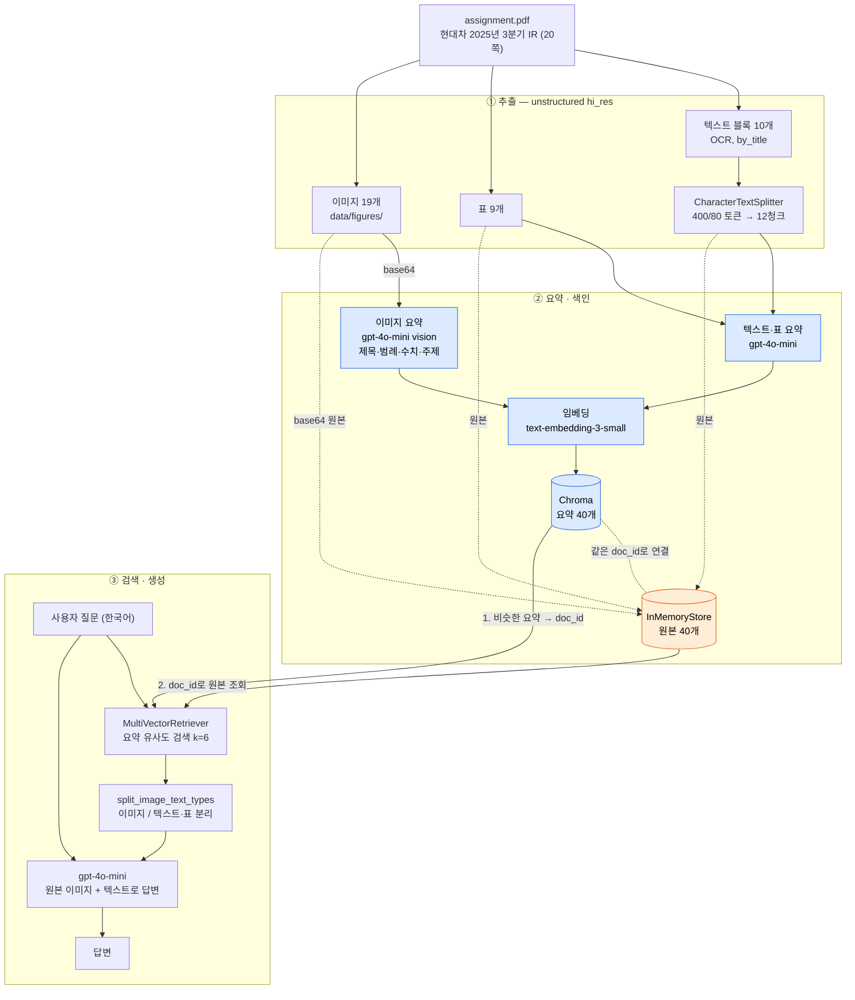

git clone [<저장소 주소>]https://github.com/Rairan0509/multimodal-rag
cd multimodal-rag

# 가상환경 생성 및 활성화
python -m venv .venv
source .venv/bin/activate          # 윈도우: .venv\Scripts\activate

# 의존성 설치
pip install --upgrade pip
pip install -r requirements.txt     # 또는 requirements.lock.txt

# 커널 등록
python -m ipykernel install --user --name multimodal-rag

# .env 작성
cp .env.example .env                # 윈도우: copy .env.example .env
# .env 파일을 열어 실제 API 키를 입력

## 1. 문제 정의

### 1-1. 대상 자료
- 자료: 현대자동차 2025년 3분기 경영실적 발표 IR 자료 (20페이지, 공개 자료, 2025.10.30 발표)
- 구성: 본문 텍스트 + 표 6개 + 그래프 23개
 - 표 (6개) : 차급별 판매, 친환경차 판매(분기별 추이), 손익계산서 요약, 손익 계산서, 재무상태표, 현금흐름표
 - 그래프 (23개)
  - 막대그래프 10개: 지역별 산업수요·도매·소매 판매(미국·유럽·국내·인도·중국·중남미·아태·아프리카&중동·기타 9개 + 글로벌 1개)
  - 도넛차트 7개: 미국·유럽·내수의 차급별/친환경차 판매 비중 6개 + 전체 차급별 판매 비중 1개
  - 워터폴 차트 2개: 매출액·영업이익 증감 요인 분석
  - 막대그래프 4개: 매출원가, 판매관리비, 영업외 손익, 당기순이익

### 1-2. 왜 텍스트는 RAG로는 부족한가
IR 자료는 핵심 정보 대부분이 표와 그래프에 있고, 본문은 짧은 요약 문구에 그친다.
- **표**: PyPDF 등으로 텍스트만 뽑으면 행/열 구조가 무너져 "매출 12.3% 11.8% 4.2%" 처럼 어떤 숫자가 어느 분기·항목인지 알 수 없다.
- **그래프**: 막대·꺾은선 그래프는 이미지라서 텍스트 추출로는 아예 잡히지 않는다.
  "최근 4분기 동안 영업이익률은 어떻게 변했니?" 같은 추세 질문에 답할 근거가 사라진다.

### 1-3. 예상 사용자와 질문
- 사용자: 기업 실적을 빠르게 파악하려는 투자자, 애널리스트
- 질문 예: "3분기 지역별 판매 비중은?", "전년 동기 대비 매출 증감률은?", "영업이익률 추세는 상승세인가?"

### 1-4. 목표
텍스트, 표, 이미지를 각각 추출해 요약하고, 요약으로 검색한 뒤 원본(표 HTML, 그래프 이미지)을 LLM에 넘겨 답변을 생성합니다. 텍스트 RAG로는 답하지 못하던 표·그래프 기반 질문에 근거를 갖춘 답변을 내는지 Before/After 비교로 확인한다.

## 2. 구조 이해 : 왜 요약으로 검색 하고 원본으로 답변하는가

### 2-1. 전체흐름
1. **추출**: unstructured로 PDF에서 텍스트, 표, 이미지를 따로 꺼낸다.
2. **요약**: 텍스트·표·이미지마다 gpt-4o-mini로 한국어 요약을 만든다.
3. **저장**: 요약은 벡터 DB에, 원본은 docstore에 같은 doc_id로 저장한다.
4. **검색**: 질문을 요약들과 비교해 비슷한 것을 찾고, 그 doc_id로 원본을 꺼낸다.
5. **생성**: 꺼낸 원본(텍스트·표 문자열, 그래프 이미지)을 LLM에 넘겨 답변을 만든다.

흐름상 요약은 찾는 용도, 원본은 답하는 용도로 역할을 나눴다.

### 2-2. 요약으로 검색하고 원본으로 답변
- 원본을 그대로 임베딩하면 질문과 잘 맞지 않는 답변을 할 수 있기 때문에 요약을 해서 질문과 비슷한 유사도 점수로 가져올 수 있다. 게다가 요약하는 과정에서 텍스트·표·이미지를 모두 텍스트요약으로 바꾸면 임베딩 모델 하나로 한 공간에서 함께 검색이 가능하다. 그렇다고 요약으로 답변을 하게되면 요약을 하는 과정에서 정보가 빠지거나 틀릴 수 있으므로 검색은 요약으로 답변은 원본으로 해야 답변 정확도가 올라간다.

## 3. 기술 선택 근거

### 3-1. 사용한 구성 요약
| 단계 | 선택 | 주요 설정 |
|---|---|---|
| 추출 | unstructured `partition_pdf` | `strategy="hi_res"`, `languages=["kor","eng"]`, `chunking_strategy="by_title"` |
| 텍스트 분할 | `CharacterTextSplitter` (tiktoken 기준) | `chunk_size=400`, `chunk_overlap=80` |
| 요약 (텍스트·표·이미지) | gpt-4o-mini | `temperature=0` |
| 임베딩 | text-embedding-3-small | — |
| 저장·검색 | Chroma + InMemoryStore (MultiVectorRetriever) | `k=6` |
| 답변 생성 | gpt-4o-mini | `temperature=0` |

### 3-2. 모델 선택
**gpt-4o-mini (요약·답변)**
- 이미지 입력을 지원해서, 텍스트·표 요약, 그래프 요약, 최종 답변을 **모델 하나로** 처리할 수 있다.
- 요약 대상이 텍스트·표 21개 + 이미지 19개이고, 검색이 안 되는 원인을 찾느라 요약을 여러 번 다시 돌렸다. 반복 실행 비용이 낮은 모델이 필요했다.

**temperature=0**
- 처음에는 이미지 요약에 temperature를 지정하지 않았는데, 다시 실행할 때마다 요약 문장이 달라졌다.
  요약이 바뀌면 같은 질문에도 검색되는 이미지가 달라져서, 결과를 비교하거나 원인을 추적할 수 없었다.
- 0으로 고정한 뒤로는 실행할 때마다 거의 같은 요약이 나와서 결과를 재현할 수 있게 됐다.

**text-embedding-3-small (임베딩)**
- 임베딩하는 대상이 원본이 아니라 **짧은 한국어 요약문**이라, 큰 임베딩 모델까지는 필요하지 않다고 판단했다.
- 요약·답변과 같은 OpenAI API 키 하나로 쓸 수 있다.

### 3-3. 추출 설정
- **hi_res**: 표와 그래프 영역을 따로 잡아내려면 레이아웃 분석 모델이 필요하다. 덕분에 표 9개와 이미지 19개를 텍스트와 분리해서 추출했다.
- **languages=["kor","eng"]**: 한국어 본문에 "Q3 2024", "SUV", "EV" 같은 영어가 섞여 있다.
- **부작용**: OCR 결과에 `현 대 자동차 2025 년 3 분 기`처럼 띄어쓰기가 깨진다. 원문을 그대로 검색하지 않고 요약으로 검색하는 이유 중 하나다.

### 3-4. 청크 크기: 1000/500 → 400/80
처음에는 `chunk_size=1000`, `chunk_overlap=500`으로 시작했다. 이 자료에는 맞지 않아서 줄였다.

- **텍스트 양이 적다**: 텍스트 전체가 3,378자뿐이다. 1000토큰이면 청크 하나에 여러 슬라이드가 들어간다.
- **IR 자료는 슬라이드마다 주제가 다르다**: 1000/500일 때 요약 하나에 "미국 M/S 6.3%", "고수익 차종 21%", "글로벌 산업수요", "북미 도매 315천 대"가 섞였다.
  주제가 섞인 요약은 임베딩이 흐려져서 특정 질문에 정확히 걸리지 않는다. 요약 과정에서 "2025년"이 "2023년"으로 바뀌는 오류도 생겼다.
- **overlap 50%는 중복이 너무 크다**: 같은 내용이 청크 2개에 들어가면, 검색 결과 자리를 중복 청크가 차지해서 표나 이미지가 들어갈 자리가 줄어든다.
- **400/80으로 변경**: 슬라이드 하나 정도 분량에 맞추고, overlap은 문장이 잘리는 것만 막는 20%로 줄였다. 텍스트 블록 10개가 청크 12개로 나뉘었다.
- `chunk_size`는 글자 수가 아니라 **토큰** 기준이다(`from_tiktoken_encoder`). 한국어는 1글자가 1토큰 이상이라 글자 수보다 빨리 찬다.

### 3-5. 프롬프트 언어
| 프롬프트 | 지시 언어 | 출력 언어 |
|---|---|---|
| 텍스트·표 요약 | 영어 | 한국어 ("Respond in Korean") |
| 이미지 요약 | 한국어 | 한국어 |
| 최종 답변 | 한국어 | 한국어 |

- **출력은 모두 한국어로 맞췄다.** 사용자 질문이 한국어이므로, 요약도 한국어여야 같은 언어끼리 임베딩을 비교해서 검색이 잘 된다.
- **이미지 요약 지시는 한국어로 바꿨다.** 범례 이름("차급별 판매", "지분법")을 이미지에 적힌 그대로 옮기게 하고, 출력 형식 예시("SUV: Q3 2024 61.7% → Q3 2025 69.5%")를 자료의 실제 표기로 보여주기 위해서다.
- **텍스트·표 요약 지시는 영어로 두었다.** 영어 지시문에 출력 언어만 한국어로 지정해도 한국어 요약이 문제없이 나왔다.

### 3-6. 검색 개수 k=4 → 6
- 기본값 k=4에서는 텍스트·표 요약이 상위를 차지해서 이미지가 들어갈 자리가 없었다.
- 6으로 늘려 텍스트와 이미지가 함께 검색될 여지를 만들었다. (이미지 요약 프롬프트 개선과 동시에 바꿨기 때문에, 각각의 효과를 따로 측정하지는 않았다.)

## 4. 아키텍처

- **파란색**: 검색에 쓰이는 요약. 질문과 비교되는 대상이다.
- **주황색**: 답변에 쓰이는 원본. 요약으로 찾은 `doc_id`로 꺼내서 LLM에 그대로 넘긴다.
- **점선**: 원본이 요약을 거치지 않고 docstore에 바로 저장되는 경로다.

## 5. 질의응답 5건 (멀티모달 RAG)

검색 개수 k=6, 답변 모델 gpt-4o-mini (temperature=0). 정답은 원본 PDF에서 직접 확인했다.

| # | 질문 | 답변 | 근거가 된 원본 종류 | 정답 (PDF) | 판정 |
|---|---|---|---|---|---|
| Q1 | 3분기 미국 시장 점유율과 고수익 차종 판매 비중은? | 3분기 미국 시장 점유율은 6.3%이며, 고수익 차종 판매 비중은 21%입니다. | 텍스트 (p.3 주요 메시지) | M/S 6.3%, 고수익 차종 21% | ✅ |
| Q2 | 3분기 매출액과 영업이익은 전분기(Q2 2025) 대비 얼마나 변했나? | 3분기(Q3 2025) 매출액은 46,721억원으로 전분기 대비 3.2% 감소하였고, 영업이익은 2,037억원으로 전분기 대비 29.6% 감소하였습니다. | 표 (p.17 손익계산서) | 매출 48,287 → 46,721 (-3.2%), 영업이익 3,602 → 2,537 (-29.6%), 단위 십억 원 | 🟡 증감률 정답, 영업이익 금액(OCR 오독)과 단위 오류 |
| Q3 | 국내 시장의 SUV 판매 비중은 전년 대비 어떻게 변했나? | 국내 시장의 SUV 판매 비중은 Q3 2024에서 45.4%였고, Q3 2025에서는 48.2%로 증가했습니다. | 이미지 (`figure-9-15.jpg`, 국내 차급별 판매 도넛차트) | 45.4% → 48.2% | ✅ |
| Q4 | 3분기 글로벌 산업수요·도매·소매 판매는 전년 대비 각각 몇 % 변했나? | 3분기 글로벌 산업수요는 전년 대비 +2.6% 변했으며, 도매는 +4.8%, 소매는 +4.8% 변했습니다. | 이미지 (`figure-6-10.jpg`, 글로벌 판매 막대그래프) | 산업수요 +4.0%, 도매 +2.6%, 소매 +4.8% | 🟡 소매만 정답. 잘린 이미지에서 "+4.0%"가 빠져 증감률이 한 칸씩 밀림 |
| Q5 | 미국 시장의 HEV 판매 비중은 전년 대비 어떻게 변했나? | 미국 시장의 HEV 판매 비중은 전년 대비 20.4%로 기록되었습니다. | 텍스트 (p.6 Market Summary) | 16.8% → 20.4% | 🟡 3분기 값만 답함. 전년 값이 있는 도넛차트(`figure-7-12.jpg`)가 검색되지 않음 |

## 6. Before / After 비교: 텍스트 RAG vs 멀티모달 RAG

### 6-1. 비교 조건
| 항목 | BEFORE: 텍스트 RAG | AFTER: 멀티모달 RAG |
|---|---|---|
| 색인 대상 | OCR 텍스트 청크 12개 (원문 그대로 임베딩) | 텍스트·표·이미지 요약 40개 |
| 답변에 넘기는 원본 | 텍스트 청크 | 텍스트 청크 + 표 + 그래프 이미지 |
| 검색 개수 | k=6 | k=6 |
| 임베딩 / 답변 모델 | text-embedding-3-small / gpt-4o-mini (temperature=0) | 동일 |
| 답변 프롬프트 | "자료를 근거로 답하고, 없는 내용은 모른다고 답하라" | 동일 |

표와 이미지를 쓰는지만 다르고, 나머지 조건은 모두 같게 맞췄다.

### 6-2. 결과 요약
| # | 질문 | 근거 원본 | BEFORE | AFTER | 결과 |
|---|---|---|---|---|---|
| Q1 | 3분기 미국 시장 점유율과 고수익 차종 판매 비중은? | 텍스트 | ✅ | ✅ | 무승부 |
| Q2 | 3분기 매출액과 영업이익은 전분기 대비 얼마나 변했나? | 표 | ❌ | 🟡 | **멀티모달 우세** |
| Q3 | 국내 시장의 SUV 판매 비중은 전년 대비 어떻게 변했나? | 도넛차트 | ❌ | ✅ | **멀티모달 우세** |
| Q4 | 3분기 글로벌 산업수요·도매·소매 판매는 전년 대비 각각 몇 % 변했나? | 막대그래프 | ❌ | ❌ | 둘 다 실패 |
| Q5 | 미국 시장의 HEV 판매 비중은 전년 대비 어떻게 변했나? | 도넛차트 | 🟡 | 🟡 | 텍스트 RAG가 더 정직 |

### 6-3. 질문별 비교

#### Q1. 텍스트에 답이 있는 질문 (대조군)

- 정답: 미국 M/S **6.3%**, 고수익 차종 비중 **21%**
- 두 RAG 모두 정답이다. 본문 텍스트에 있는 정보는 텍스트 RAG로도 충분하고, 멀티모달 RAG가 텍스트 질문의 성능을 떨어뜨리지 않는다는 것을 확인했다.

#### Q2. 표에만 있는 정보

- 정답: 매출 48,287 → 46,721 (**-3.2%**), 영업이익 3,602 → 2,537 (**-29.6%**) (단위: 십억 원)
- **BEFORE**: "영업이익 -1,044억원, -29.2% 감소"라고 답했다. 이 숫자는 워터폴 차트에 있는 **전년 대비** 수치다. 전분기 데이터는 표에만 있는데, 텍스트 RAG에는 표가 없어서 비슷한 숫자를 전분기 수치처럼 가져다 썼다.
- **AFTER**: 손익계산서 표를 검색해서 증감률 -3.2%, -29.6%를 정확히 답했다. 단, 영업이익 금액을 2,537이 아니라 **2,037**로 답했는데, 표 OCR에서 숫자를 잘못 읽은 것이다.

#### Q3. 그래프의 범례를 봐야 알 수 있는 정보

- 정답: **45.4% → 48.2%**
- **BEFORE**: "33.6% → 48.2%"로 답했다. OCR 텍스트에는 도넛차트의 숫자들(45.4%, 48.2%, 35.8%, 33.6% ...)이 **항목 이름 없이** 나열되어 있어서, PV 비중인 33.6%를 SUV 비중으로 잘못 짝지었다.
- **AFTER**: 국내 차급별 판매 도넛차트(`figure-9-15.jpg`)를 검색하고, 이미지의 범례 색을 보고 SUV 비중을 정확히 읽었다.

#### Q4. 검색은 성공했지만 원본 이미지가 불완전한 경우

- 정답: 산업수요 **+4.0%**, 도매 **+2.6%**, 소매 **+4.8%**
- **BEFORE**: "+6.3% / +6.3% / -0.4%"로 답했다. 미국·국내·인도 등 다른 지역의 증감률을 가져왔다.
- **AFTER**: 정답 그래프(`figure-6-10.jpg`)를 검색하는 데는 성공했지만, 추출된 이미지 위쪽이 잘려서 **"+4.0%" 글자가 빠져 있었다.** 그래서 남은 증감률을 엉뚱한 항목에 붙였다.
- 검색이 맞아도 **원본이 불완전하면 답변이 틀린다**는 사례다.

#### Q5. 멀티모달 RAG가 오히려 부정확했던 경우

- 정답: **16.8% → 20.4%**
- **BEFORE**: "20.4%로 기록됐지만, 전년 대비 변화는 알 수 없다"고 답했다. 자료의 한계를 정직하게 밝혔다.
- **AFTER**: 전년 값이 있는 미국 친환경차 도넛차트(`figure-7-12.jpg`)를 검색하지 못했고, "**전년 대비** 20.4%로 기록"이라고 답했다. 변화량이 20.4%인 것처럼 읽혀서 텍스트 RAG보다 오해의 소지가 크다.

### 6-4. 비교에서 알게 된 점
- **텍스트 RAG의 진짜 문제는 "모른다"가 아니라 "틀린 숫자로 자신 있게 답한다"는 것이다.**
  OCR 텍스트에도 표·그래프의 숫자는 들어 있다. 하지만 어느 항목·어느 기간의 숫자인지 연결이 끊겨서, Q2와 Q3처럼 그럴듯한 오답을 만든다.
- **멀티모달 RAG는 표와 범례가 있는 그래프에서 확실히 강하다.** (Q2, Q3)
- **멀티모달 RAG도 만능은 아니다.** 원본 이미지가 잘리면 답이 틀리고(Q4), 이미지 요약에 핵심 단어가 없으면 검색되지 않는다(Q5).
